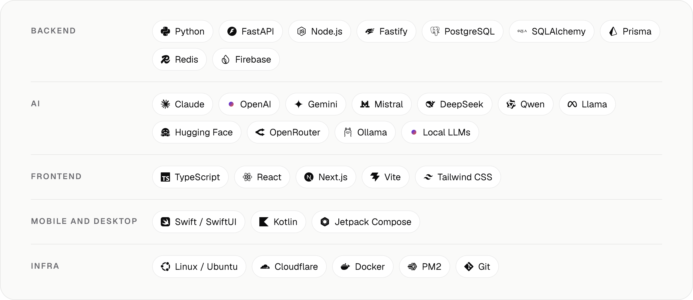

<a href="https://virusofficial.dev">
  <picture>
    <source media="(prefers-color-scheme: dark)" srcset="assets/header-dark.png">
    
  </picture>
</a>

<p align="center">
  <a href="https://virusofficial.dev"><b>virusofficial.dev</b></a> &nbsp;·&nbsp;
  <a href="https://virusofficial.dev/contact">Start a project</a> &nbsp;·&nbsp;
  <a href="mailto:hello@virusofficial.dev">hello@virusofficial.dev</a> &nbsp;·&nbsp;
  <a href="https://wa.me/@virus.dev.official">WhatsApp</a>
</p>

<br>

Hey, I'm **Virus**. I build backends, AI features and the apps on top of them: web apps, native iOS, macOS and Android apps, and the APIs behind them.

I work by the project. Hand me yours and I'll build it from start to finish, or add me to your team until it ships. My partner on every build is [Claude Code](https://claude.com/claude-code).

<br>

### Shipped

**[ogee](https://github.com/virus-dev-official/ogee)** &nbsp;·&nbsp; Link previews for single-page apps, drawn at the edge. One Cloudflare Worker gives every page its own title, description and a preview card in your brand, plus a sitemap and `llms.txt`. Built for coding agents. Open source, MIT.

```bash
npx @virusdev/ogee check https://your.site
```

<br>

### Stack

<picture>
  <source media="(prefers-color-scheme: dark)" srcset="assets/stack-dark.png">
  
</picture>

<br>

### Elsewhere

[X](https://x.com/virus_dev_off) &nbsp;·&nbsp; [YouTube](https://www.youtube.com/@virus.dev.official) &nbsp;·&nbsp; [TikTok](https://www.tiktok.com/@virus.dev.official) &nbsp;·&nbsp; [Instagram](https://www.instagram.com/virus.dev.official)
